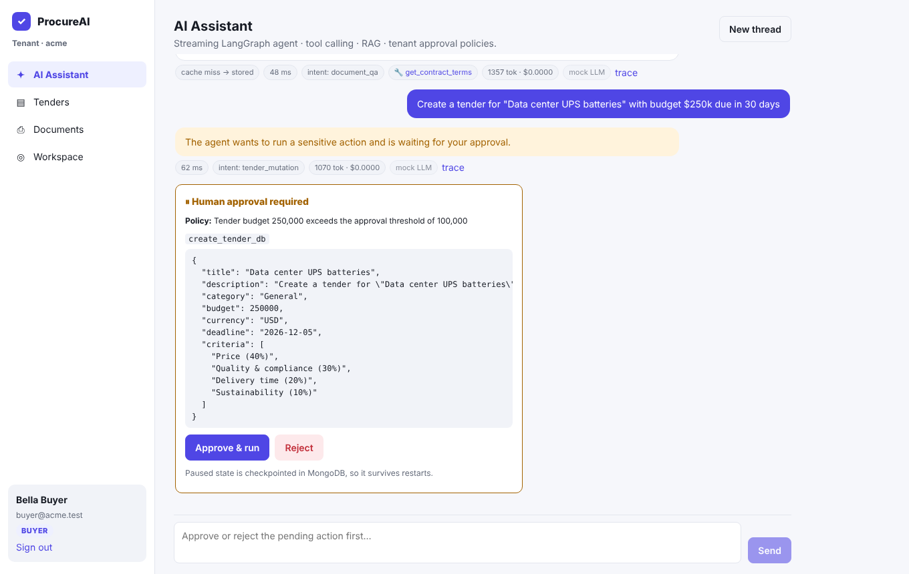
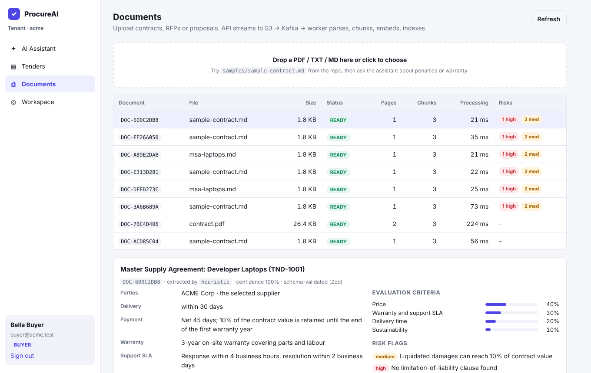
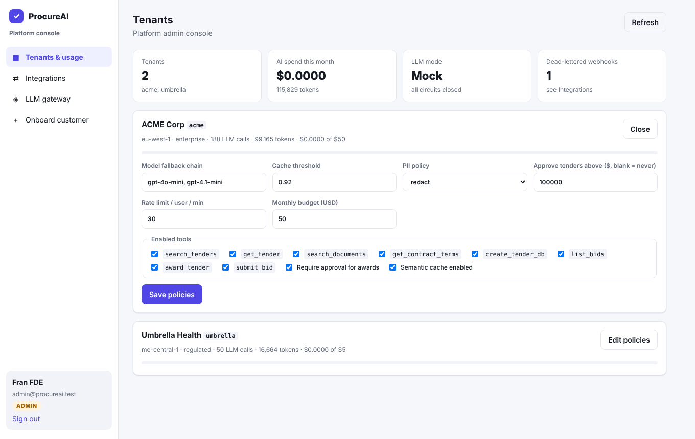
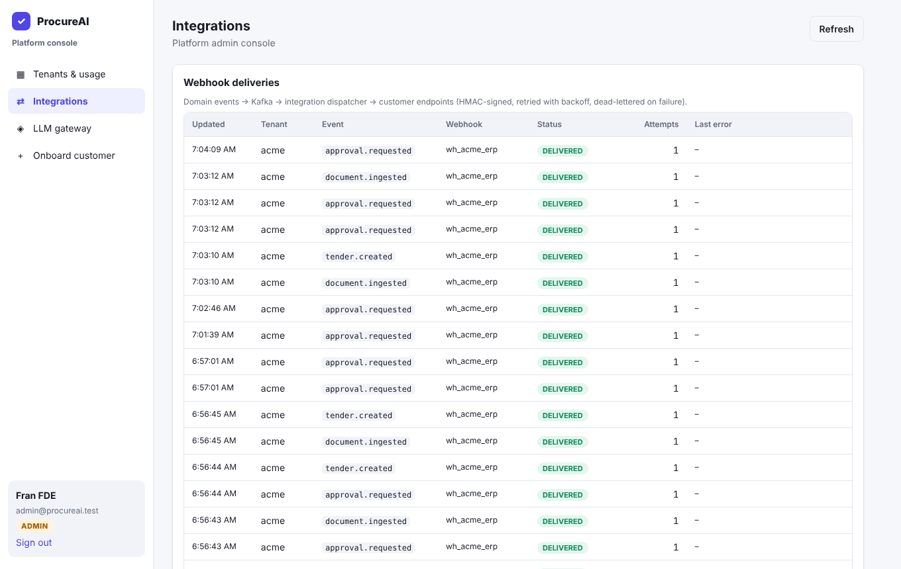
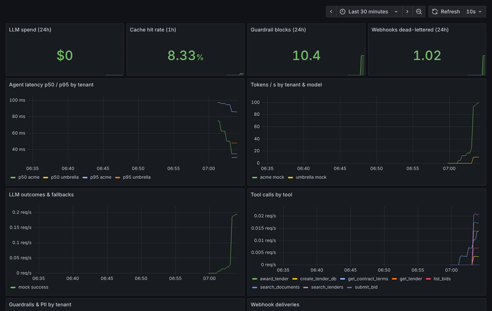
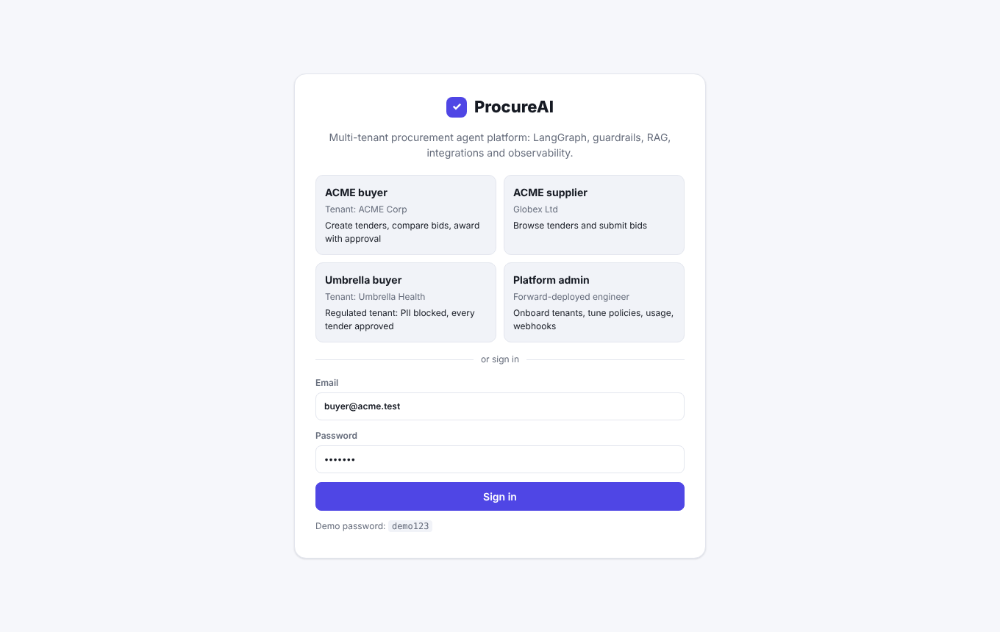

# ProcureAI: multi-tenant AI agent platform for procurement

A production-style **LangChain / LangGraph** platform built the way a **forward-deployed engineer** ships AI into
customer environments. It onboards many customers as isolated tenants with their own policies, plugs into their systems
through signed webhooks and MCP, proves quality with evals in CI, and runs with metering, guardrails and observability.

It runs **fully offline without an OpenAI key** (deterministic mock LLM + hash embeddings) and switches to OpenAI as soon as you add one.

```
                          ┌──────────────────────── API gateway (Express + TS) ────────────────────────┐
 React (Vite) ─ nginx ──► │ JWT ─ tenant resolve ─ rate limit/budget ─ injection guard ─ PII policy     │
   SSE stream ◄────────── │ Redis semantic cache (per tenant+role, HNSW cosine)                         │
 Claude Desktop ─ /mcp ─► │ LangGraph supervisor ─► LLM gateway (fallback chain, circuit breaker, $)    │
                          │      ├─ Zod tools, tenant-scoped (Mongo)   ├─ HITL interrupt (policy-driven) │
                          │      └─ checkpoints in MongoDB (durable)   └─ domain events ─► Kafka         │
                          └───────────── upload ─► S3 ─► Kafka document.ingest ─► 202 ──────────────────┘
 Worker (2 consumer groups)
   ingestion-workers      : S3 stream → parse → chunk → batch embed → Mongo vectors → structured contract extraction
   integration-dispatcher : procurement.events → HMAC-signed webhooks to customer ERP → retries → DLQ → admin replay
 Observability: Prometheus /metrics (api + worker) → Grafana dashboard + alert rules · LangSmith traces
 Quality: evals/ dataset + gates → GitHub Actions (typecheck, unit tests, Docker e2e, demos, eval gates)
```

## Screenshots

| Streaming agent with tenant approval policy | Structured contract extraction + risk flags |
|---|---|
|  |  |
| **Admin console: tenants, usage, policies** | **Integrations: signed webhooks, DLQ, replay** |
|  |  |
| **Grafana: AI platform overview** | **Login: tenants and roles** |
|  |  |

## Quick start

```bash
git clone https://github.com/darshan82/ProcureAI.git
cd ProcureAI
cp .env.example .env        # optional: put your OPENAI_API_KEY in .env (git-ignored)
docker compose up -d --build
```

Open **http://localhost:8080** and pick a persona (password `demo123`):

| User | Tenant | Role | Try |
|---|---|---|---|
| buyer@acme.test | ACME Corp | BUYER | approvals, contract summary, bids |
| supplier@globex.test | ACME Corp | SUPPLIER | submit bids, RBAC refusals |
| buyer@umbrella.test | Umbrella Health (regulated) | BUYER | PII **blocked**, every tender needs approval |
| supplier@stark.test | Umbrella Health | SUPPLIER | |
| admin@procureai.test | platform | ADMIN | onboard tenants, tune policies, usage, webhook replay, LLM gateway |

```bash
node scripts/demo.mjs all          # 9 live demos, 40+ checks
node evals/run.mjs                 # eval suite + quality gates → evals/reports/latest.md
docker compose --profile observability up -d   # + Prometheus :9090 and Grafana :3000
```

### Adding your OpenAI key
Put `OPENAI_API_KEY=sk-...` in `.env`, then run `docker compose up -d api worker`. Each tenant's `models` list becomes its fallback chain
(e.g. `gpt-4o-mini → gpt-4.1-mini`), tokens stream live over SSE, contract extraction switches to structured output, and real token costs
are metered per tenant. Optional: `LANGSMITH_TRACING=true` + `LANGSMITH_API_KEY` (runs are tagged by tenant, role and user).
Re-upload documents after switching, so they're embedded with the new model. `.env` is git-ignored.

## What a forward-deployed engineer gets here

| Area | What it does | Where |
|---|---|---|
| **Multi-tenancy** | Row-level isolation on every collection, cache and thread; config-as-code onboarding (`apps/api/tenants/*.json`) + admin API; versioned Mongo migration from v1 | `services/tenants.ts`, `services/mongo.ts` |
| **Per-tenant policy** | Model chain, cache threshold, PII `redact`/`block`, enabled tools, approval rules (awards, tenders above $X), rate limit, monthly budget, webhooks | `tenants/*.json`, admin console |
| **LLM gateway** | Fallback chain, per-model circuit breaker, degraded mode, token + $ metering per tenant | `agent/llmGateway.ts`, `services/usage.ts` |
| **Agent** | LangGraph supervisor, Zod tools, 3-layer authz (bound tools, in-tool checks, tenant scoping), policy-driven HITL `interrupt()`, durable MongoDB checkpointer | `agent/*` |
| **Streaming** | SSE: graph steps + tokens, nginx unbuffered | `routes/chat.ts`, `api.ts` |
| **RAG + extraction** | Async ingestion (S3 → Kafka → worker), chunking, batch embeddings, vector search; **structured contract extraction** (Zod schema, `withStructuredOutput`) + rule-based risk flags | `apps/worker/src/*` |
| **Integrations** | Domain events → Kafka → **HMAC-signed webhooks** with retries, idempotency, **DLQ + replay**; mock customer ERP that verifies signatures | `worker/src/dispatcher.ts`, `routes/hooks.ts` |
| **MCP server** | Streamable HTTP `/mcp`: Claude Desktop / IDE agents use the tools with the same JWT, tenancy and RBAC | `mcp/server.ts`, [docs/INTEGRATIONS.md](docs/INTEGRATIONS.md) |
| **Security** | Prompt-injection guard, PII scrubbing on input *and* tool output, JWT + RBAC, rate limiting, budgets, audit log | `lib/*`, `middleware/*` |
| **Evals** | 28-case dataset: tool selection, RAG, RBAC, isolation, approvals, attacks vs benign, PII, latency; optional LLM-as-judge; CI gates | `evals/` |
| **Observability** | Prometheus metrics (latency, tokens, cost, cache, guardrails, tools, HITL, webhooks, ingestion), Grafana dashboard, alert rules | `lib/metrics.ts`, `infra/observability/` |
| **Delivery** | Multi-stage Alpine images, health-gated Compose, GitHub Actions CI, ECS Fargate task defs + deploy script | `.github/`, `infra/aws/` |

Docs: [Architecture](docs/ARCHITECTURE.md) · [Integrations (webhooks, MCP)](docs/INTEGRATIONS.md) · [Runbook](docs/RUNBOOK.md) · [AWS](infra/aws/README.md)

## Local development

```bash
docker compose up -d mongo redis kafka s3
cd apps/api    && npm ci && S3_ENDPOINT=http://localhost:4566 S3_ACCESS_KEY_ID=test S3_SECRET_ACCESS_KEY=test npm run dev
cd apps/worker && npm ci && S3_ENDPOINT=http://localhost:4566 S3_ACCESS_KEY_ID=test S3_SECRET_ACCESS_KEY=test npm run dev
cd apps/web    && npm ci && npm run dev     # http://localhost:5173, proxies /api → :4000
```

Unit tests: `npm test` in `apps/api` (guardrails, PII, intent, embeddings, webhook signatures, approval policy) and `apps/worker` (contract extraction).
